<p align="center">
  
</p>

<h3 align="center">Train, eat and recover with a coach who knows you.</h3>

<p align="center">
  Workouts, food and recovery in one app for iPhone and Android,<br>
  with Max, an AI coach who plans your week and changes it as you go.
</p>

<p align="center">
  <a href="https://github.com/SamayW/ethos-release/releases/latest/download/Ethos.ipa"></a>
  &nbsp;
  <a href="https://github.com/SamayW/ethos-release/releases/download/android-feed/Ethos.apk"></a>
</p>

<p align="center">
  <a href="https://github.com/SamayW/ethos-release/releases/latest"></a>
  &nbsp;Always the newest version
</p>

<p align="center">
  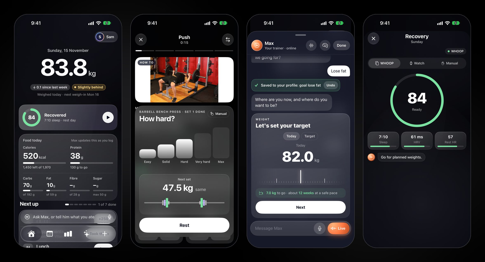
</p>

## Install

### iPhone

Ethos isn't on the App Store yet. You install it with a free sideloading app that signs it with your own Apple ID.

| You need | |
|---|---|
| iPhone on iOS 26 or later | **[Download Ethos](https://github.com/SamayW/ethos-release/releases/latest/download/Ethos.ipa)**, always the latest |
| SideStore or AltStore | Free, from [sidestore.io](https://sidestore.io) or [altstore.io](https://altstore.io) |

1. Install **SideStore** or **AltStore** on your iPhone and follow its setup.
2. Download **Ethos.ipa** on your iPhone, share it to SideStore or AltStore and tap **Install**.
3. Open Ethos and sign in with **Google** or your **email**. No password: you get a 6-digit code.

**Get updates in the app:** add this source in SideStore or AltStore.

```
https://github.com/SamayW/ethos-release/releases/latest/download/altstore-source.json
```

Free Apple IDs need apps refreshed every 7 days. SideStore and AltStore do it in the background. Your data stays put either way.

### Android

| You need | |
|---|---|
| Android 9 or later | **[Download Ethos.apk](https://github.com/SamayW/ethos-release/releases/download/android-feed/Ethos.apk)**, always the latest |

1. Download **Ethos.apk** on your phone and open it.
2. If Android asks, let your browser **install unknown apps**, then tap **Install**.
3. Open Ethos and sign in with **Google** or your **email**. Your plan, food and workouts are the same as on iPhone.

**Updates are automatic.** Ethos checks for a new version when you open it and every few hours. The first time, Android asks you to tap **Update**. On Android 12 and later, updates after that install by themselves. You can turn this off in **You › Updates**.

## What's inside

### Max

Max is your coach. He asks what he needs, one small question at a time, then builds your week. Nothing goes into your plan until you say so.

<table>
  <tr>
    <td width="50%" valign="top">
      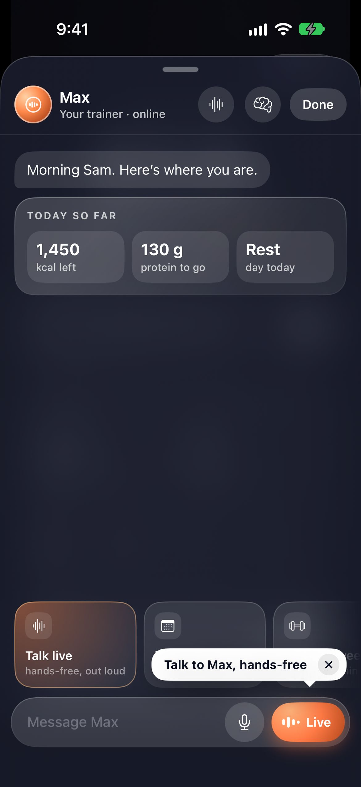
      <p><b>Chat.</b> Ask anything. Max knows your plan, your food and how you slept, and can change things for you, with Undo.</p>
    </td>
    <td width="50%" valign="top">
      
      <p><b>Cards, not forms.</b> Rulers you drag, a body map, options you tap. You can always type your own answer.</p>
    </td>
  </tr>
  <tr>
    <td width="50%" valign="top">
      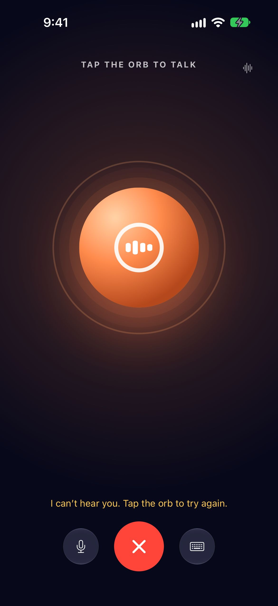
      <p><b>Live voice.</b> Talk to Max out loud. Listening runs on your iPhone.</p>
    </td>
    <td width="50%" valign="top">
      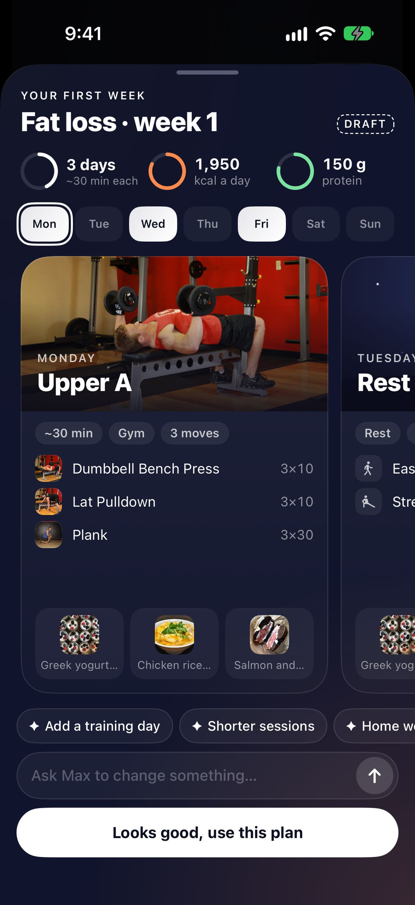
      <p><b>Your week.</b> Workouts and meals for every day. Ask for changes, then tap <b>Use this plan</b>.</p>
    </td>
  </tr>
</table>

### Training

<table>
  <tr>
    <td width="50%" valign="top">
      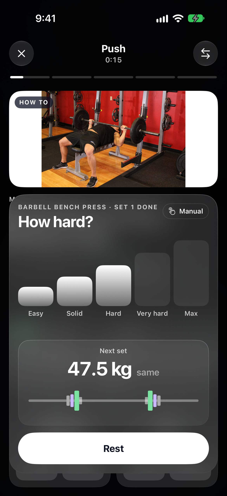
      <p><b>Effort after every set.</b> Tap how hard it felt. Ethos picks the next weight and draws the plates.</p>
    </td>
    <td width="50%" valign="top">
      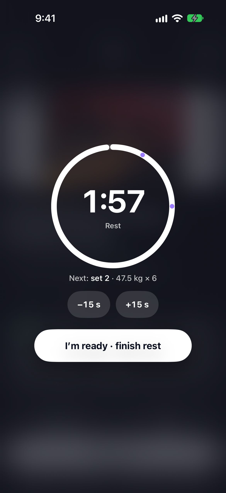
      <p><b>Rest timer.</b> Shows the next set, adds or cuts 15 seconds, and Max can call the time.</p>
    </td>
  </tr>
  <tr>
    <td width="50%" valign="top">
      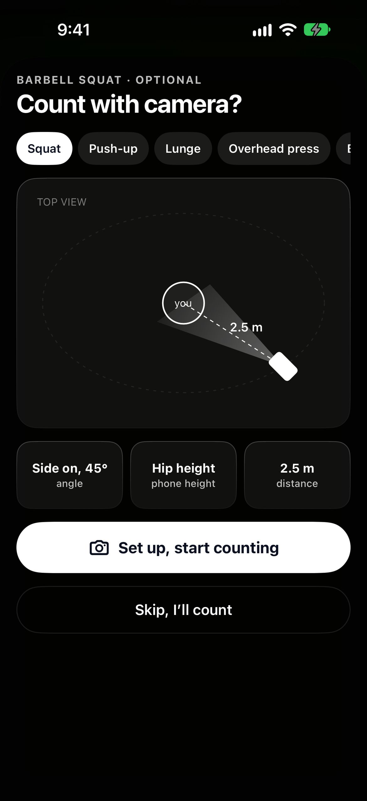
      <p><b>Camera rep counting.</b> For 8 moves. A top view shows where to put the phone. Video stays on your iPhone.</p>
    </td>
    <td width="50%" valign="top">
      <p><b>Hands-free.</b> Say "Log 8 at 60", "Add 30 seconds" or "Next exercise" mid-workout. Heart rate from WHOOP or a chest strap fills in your effort.</p>
      <p><b>Warm-up and pain check</b> before the first big lift, with swaps when something hurts.</p>
    </td>
  </tr>
</table>

### Food

<table>
  <tr>
    <td width="50%" valign="top">
      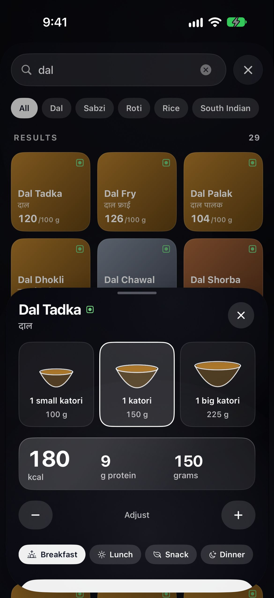
      <p><b>Indian food, properly.</b> 405 dishes with katori, roti and plate portions. Search in English or Hindi.</p>
    </td>
    <td width="50%" valign="top">
      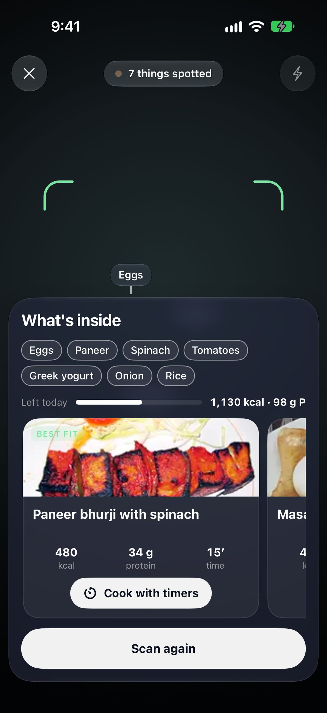
      <p><b>Fridge scan.</b> Snap the shelves. Max suggests three meals that fit what's left today, with timed steps.</p>
    </td>
  </tr>
  <tr>
    <td width="50%" valign="top">
      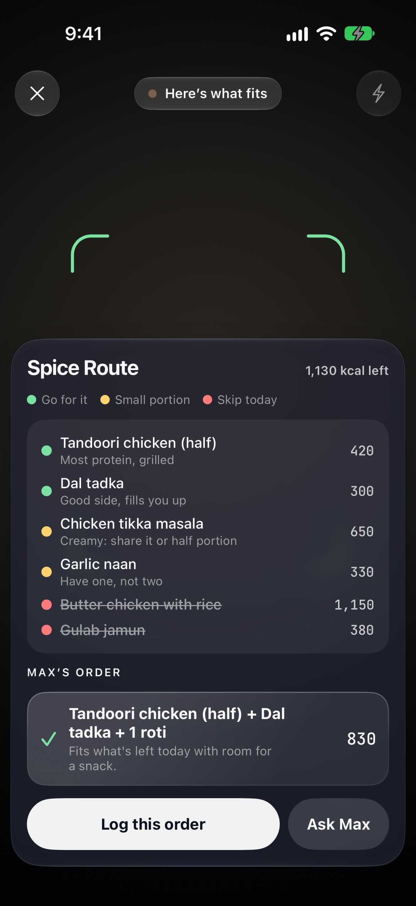
      <p><b>Menu scan.</b> Every dish marked go, small or skip, plus an order that fits your day. Log it in one tap.</p>
    </td>
    <td width="50%" valign="top">
      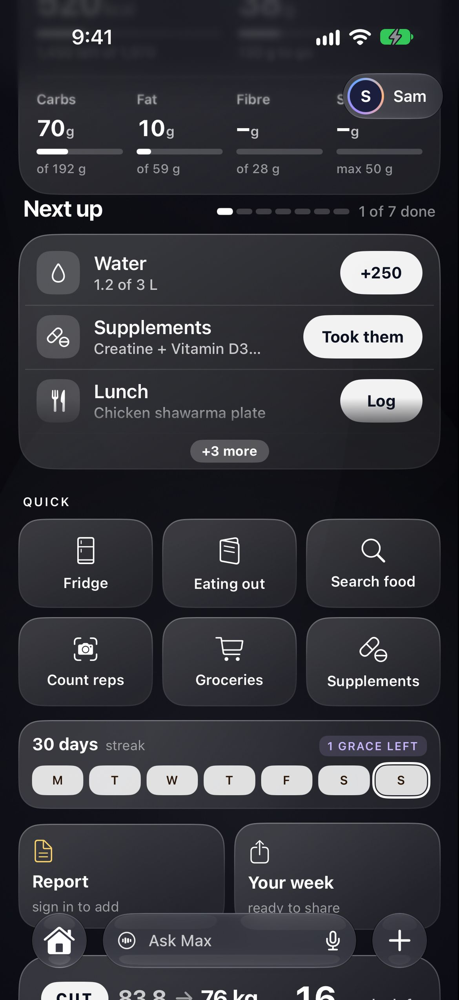
      <p><b>One camera for food.</b> Meals, barcodes, labels, fridge and menus. Quick actions sit on Today.</p>
    </td>
  </tr>
</table>

### Recovery and health

<table>
  <tr>
    <td width="50%" valign="top">
      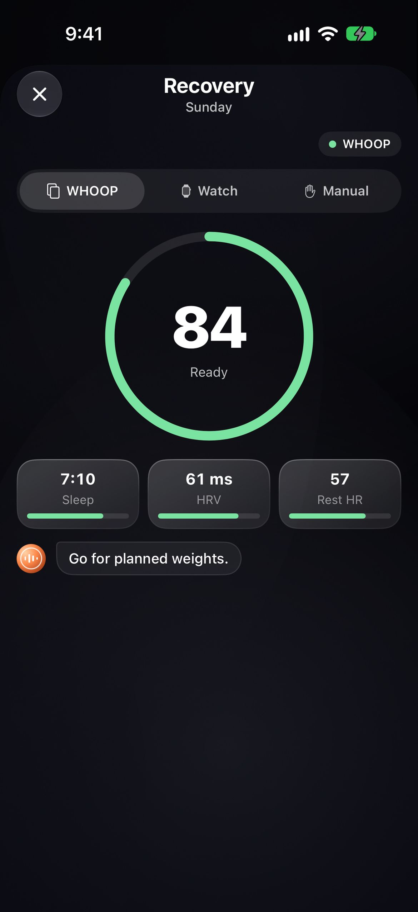
      <p><b>Recovery.</b> A daily score from WHOOP, Apple Watch, or how you slept. Tap once for a lighter session.</p>
    </td>
    <td width="50%" valign="top">
      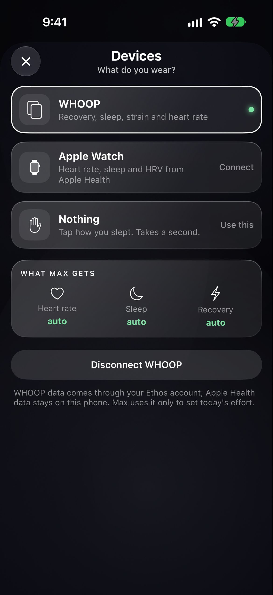
      <p><b>Devices.</b> Connect WHOOP, use Apple Watch through Apple Health, or nothing at all.</p>
    </td>
  </tr>
  <tr>
    <td width="50%" valign="top">
      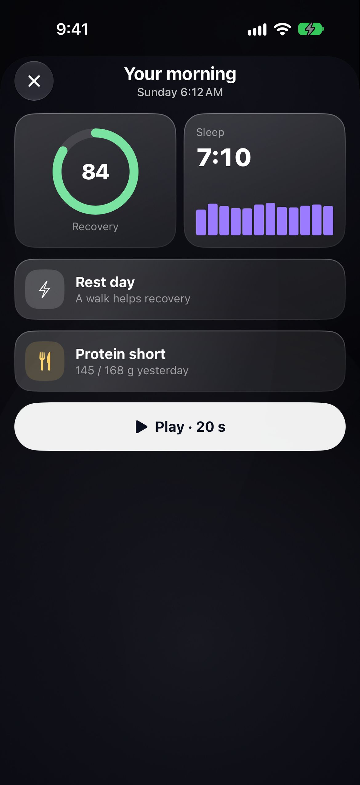
      <p><b>Morning brief.</b> Recovery, sleep, today's session and yesterday's protein. Play it as 20 seconds of audio.</p>
    </td>
    <td width="50%" valign="top">
      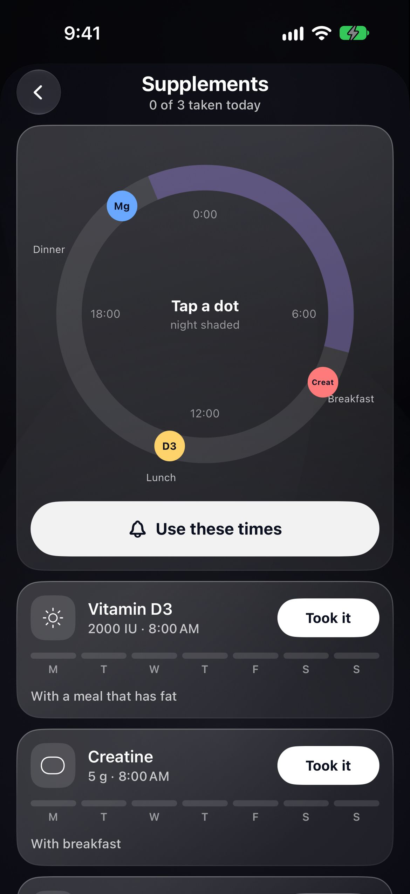
      <p><b>Supplement clock.</b> When to take each one and why, with reminders.</p>
    </td>
  </tr>
</table>

**Health reports.** Add a blood test and Max turns it into food changes. Reports need an Ethos account.

### Progress

<table>
  <tr>
    <td width="50%" valign="top">
      
      <p><b>Your story.</b> Weight, strength and wins over time, and when you'll reach your goal at this pace.</p>
    </td>
    <td width="50%" valign="top">
      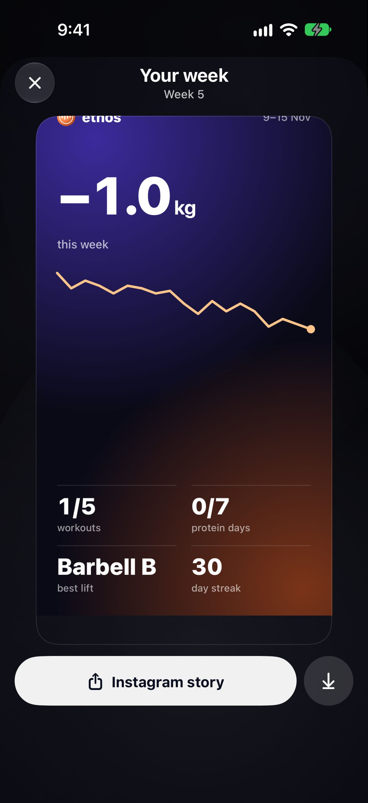
      <p><b>Share your week.</b> A card for Instagram stories or Photos. Every Sunday there's a recap too.</p>
    </td>
  </tr>
  <tr>
    <td width="50%" valign="top">
      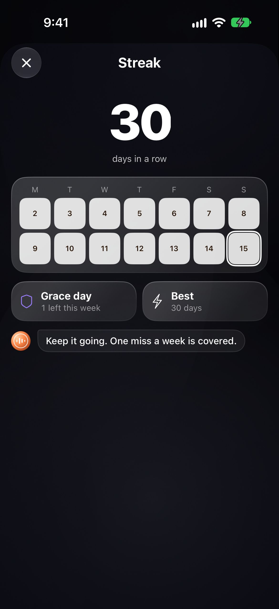
      <p><b>Streak with grace days.</b> One missed day a week doesn't break it.</p>
    </td>
    <td width="50%" valign="top">
      
      <p><b>Today.</b> Weight, recovery, food left and what's next, on one screen.</p>
    </td>
  </tr>
</table>

## Plans

| | Free | Lite | Plus | Pro |
|---|---|---|---|---|
| Today, plan, workouts, logging, progress | ✓ | ✓ | ✓ | ✓ |
| Cloud sync and backup | ✓ | ✓ | ✓ | ✓ |
| Chats with Max a day | 20 | 60 | 150 | 400 |
| Food photo, label, fridge and menu scans a day | 10 | 30 | 80 | 200 |
| Max remembers you across devices | – | – | ✓ | ✓ |
| Weekly plan check-ins | – | – | ✓ | ✓ |
| Medical report reading, monthly deep review | – | – | – | ✓ |
| Monthly | – | AED 9.99 | AED 22.99 | AED 26.99 |
| Yearly | – | AED 99.99 | AED 229.99 | AED 269.99 |

You pay on the Ethos website, never in the app. You can also use your own Anthropic key, which skips the daily limits.

## Ethos Classic

Prefer the original design? **[Ethos Classic](https://github.com/SamayW/ethos-release/releases/tag/classic-0.1)** is still here. It installs next to the new Ethos, with its own icon and its own data.

## Your data

- **Your account lives on the Ethos server.** Your plan, logs and Max's memory are backed up there on every plan, including Free. Your iPhone keeps a copy, so the app works offline.
- **Sensitive data is encrypted on the server**, with a key per person. That covers health details, reports, WHOOP data and Max's memory.
- **Apple Health data stays on your iPhone.** Max gets a short summary, like today's recovery, when he coaches you.
- **WHOOP connects through your Ethos account.** Your phone never holds WHOOP tokens. Disconnect any time in **Devices**.
- **Voice.** Listening runs on your iPhone. Max's voice can run on your iPhone too, or through the Ethos server.
- **Camera rep counting** runs on your iPhone. Video never leaves it.
- **Export or delete** everything from **You › Data & privacy**, any time.

## Report a problem

Open an [issue](https://github.com/SamayW/ethos-release/issues) with your app version (**You › About**), your iPhone model and what happened.

---

<p align="center">Made by <b>Samay Wadhwani</b> · <a href="https://github.com/SamayW/ethos-release/releases">All releases</a></p>
