

  

<h3 align="center">Your trainer. In your pocket. Every day.</h3>

  Food, training and progress in one iPhone app, 
  with Max, an AI coach who gets to know you and changes your plan every week based on how you're actually doing.

  

  
  &nbsp;Always the newest version

  

## Download

| Your phone | |
|---|---|
| iPhone on iOS 26 or later | **[Download Ethos](https://github.com/SamayW/ethos-release/releases/latest/download/Ethos.ipa)**, always the latest |
| Android | Coming later |

### Install

Ethos isn't on the App Store yet, so you install it with a free sideloading app that signs it with your own Apple ID.

1. Install **[SideStore](https://sidestore.io)** or **[AltStore](https://altstore.io)** on your iPhone and follow its setup.
2. On your iPhone, download **Ethos.ipa** from the button above.
3. Share it to SideStore or AltStore and tap **Install**.
4. Open Ethos and sign in with **Google** or your **email**. There's no password: you get a 6-digit code.

Free Apple IDs need apps refreshed every 7 days. SideStore and AltStore do this for you in the background; your data stays safe either way.

## Meet Max

Max is your coach. He doesn't hand you a form. He asks what he needs, one small question at a time, the way a real trainer would: your goal, your weight today and where you want to be, anything that hurts, how you eat, how you like to train. Then he builds your first week, shows it to you as a draft, and only puts it in your plan when you say so.

<table>
  <tr>
    <td width="50%" valign="top">
      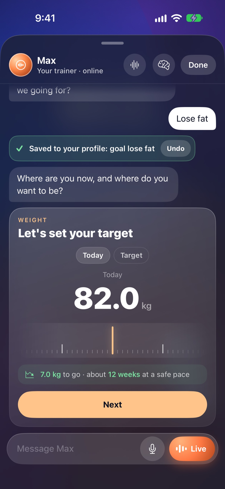
      
<b>Questions you tap, not forms you fill.</b> Rulers you drag, a body map, swipe-to-love foods. You can always type your own answer.

    </td>
    <td width="50%" valign="top">
      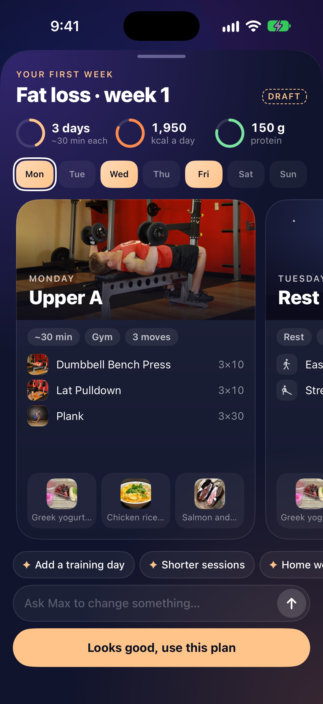
      
<b>Nothing changes without you.</b> Preview the week, ask Max to change anything, then tap <b>Use this plan</b>.

    </td>
  </tr>
  <tr>
    <td width="50%" valign="top">
      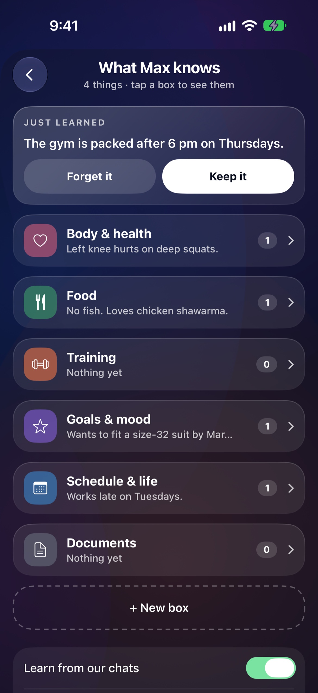
      
<b>He remembers.</b> Your taste, injuries, routines and reports, in boxes you can read, edit or delete.

    </td>
    <td width="50%" valign="top">
      
<b>Talk out loud.</b> Go hands-free mid-workout and Max talks back.

    </td>
  </tr>
</table>

## What's inside

<table>
  <tr>
    <td width="50%" valign="top">
      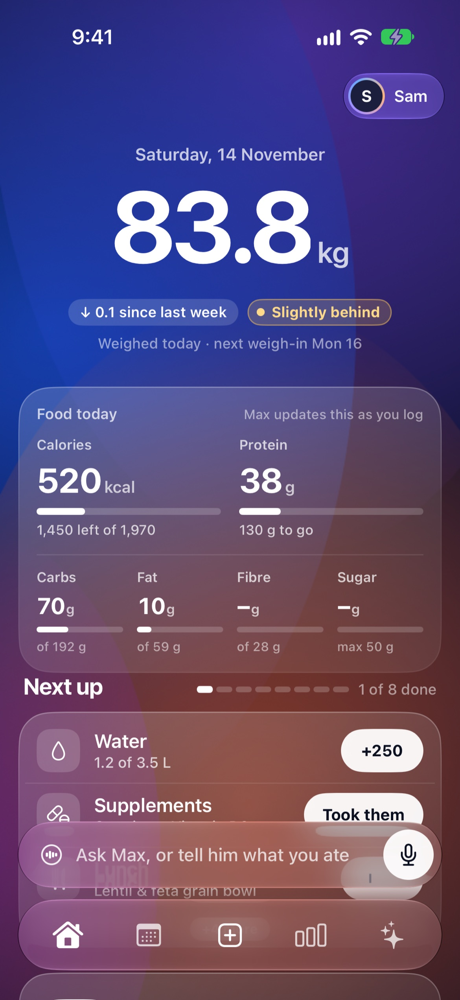
      
<b>Today.</b> What's next, what's left to eat, and how your week is going, on one calm screen.

    </td>
    <td width="50%" valign="top">
      
<b>One camera for food.</b> Snap a meal, a barcode, a label or a menu, and Ethos logs it.

    </td>
  </tr>
  <tr>
    <td width="50%" valign="top">
      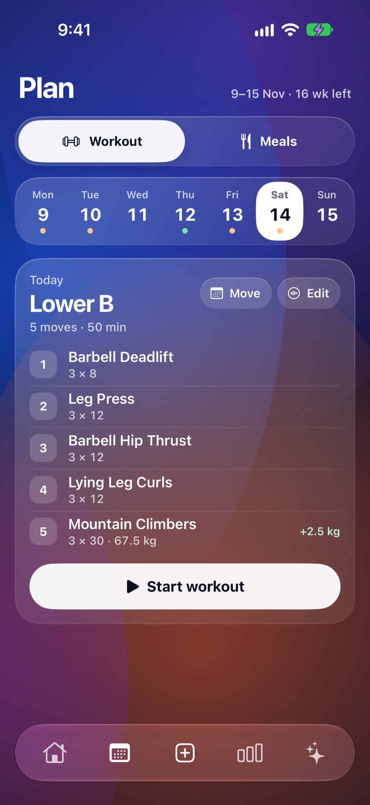
      
<b>Plan.</b> Workouts and meals for the week. Swipe days, open recipes, swap anything, and get a shopping list.

    </td>
    <td width="50%" valign="top">
      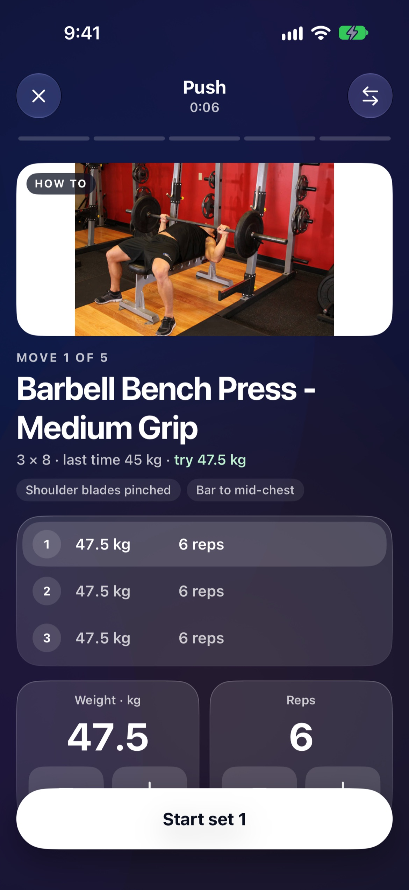
      
<b>Live workouts.</b> Pictures for every exercise, set-by-set weights, rest timers, and week-one weight calibration.

    </td>
  </tr>
  <tr>
    <td width="50%" valign="top">
      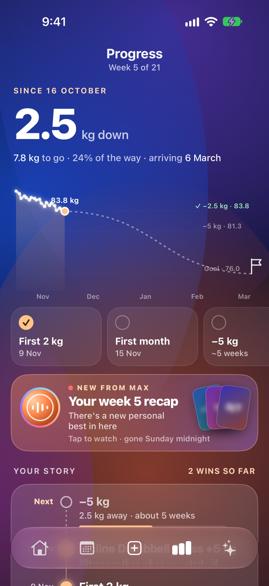
      
<b>Your story.</b> Weight, strength and wins over time, not just a line on a chart.

    </td>
    <td width="50%" valign="top">
      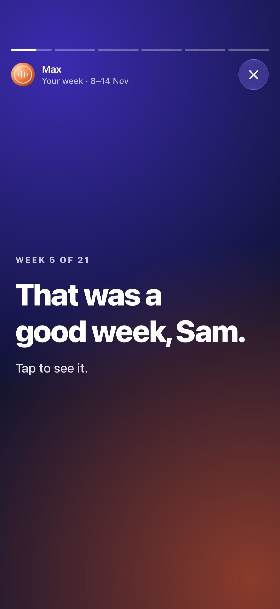
      
<b>Weekly recap.</b> Every Sunday, your week as stories, with Max's changes for next week.

    </td>
  </tr>
</table>

## Plans

| | Free | Lite | Plus | Pro |
|---|---|---|---|---|
| Today, plan, workouts, logging, progress | ✓ | ✓ | ✓ | ✓ |
| Chats with Max a day | 20 | 60 | 150 | 400 |
| Food photo and label scans a day | 10 | 30 | 80 | 200 |
| Cloud sync and backup | ✓ | ✓ | ✓ | ✓ |
| Max remembers you across devices | – | – | ✓ | ✓ |
| Weekly plan check-ins | – | – | ✓ | ✓ |
| Medical report reading, monthly deep review | – | – | – | ✓ |

**Lite** AED 9.99, **Plus** AED 22.99 and **Pro** AED 26.99 a month, or AED 99.99, 229.99 and 269.99 a year. You pay on our website, never in the app. You can also use your own Anthropic key, which skips the daily limits.

## Themes

  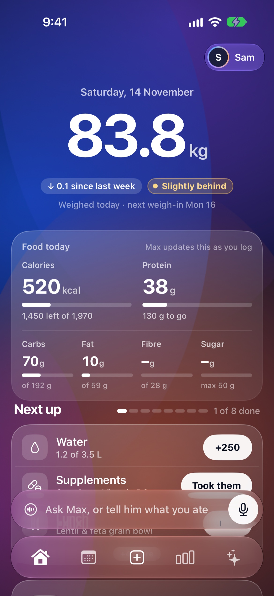
  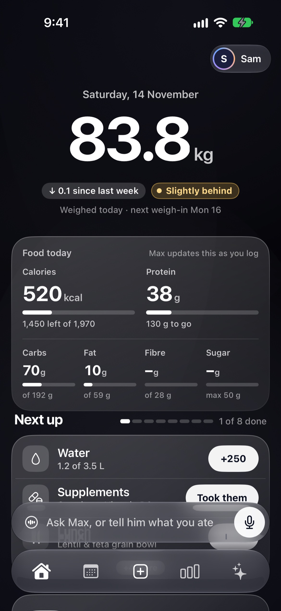
  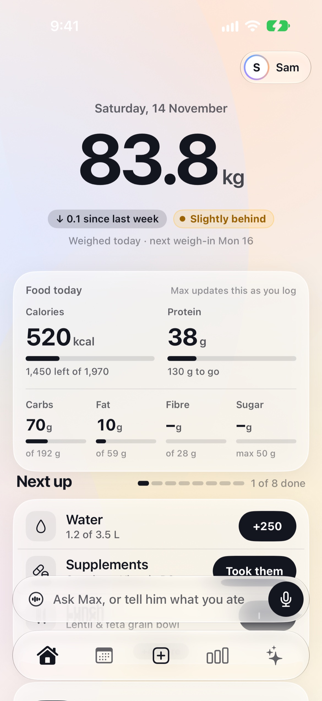
  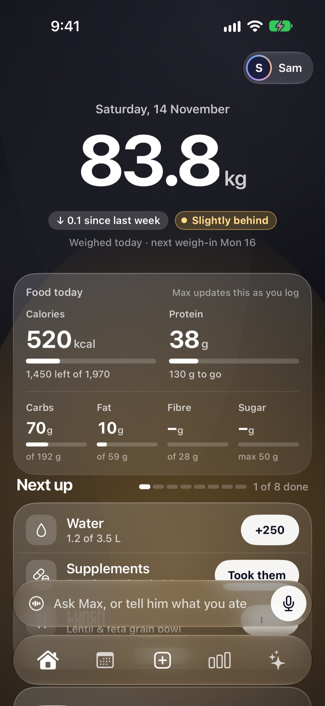
  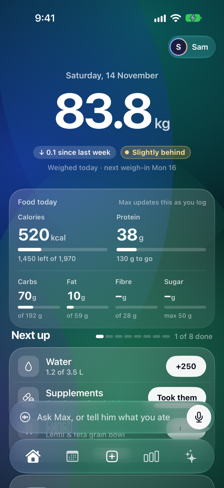
  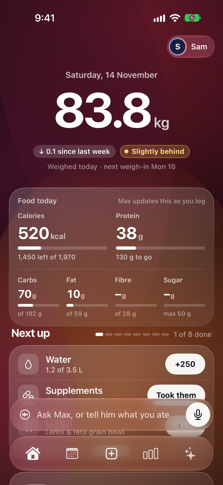

## Your data

- **You sign in through the Ethos server**, with Google or an email code. Your plan, logs and Max's memory are backed up there on every plan, including Free, and follow you to a new phone. The app always keeps a copy on your iPhone, so it works offline.
- **Health details and reports are encrypted**, each person with their own key. Uploaded reports are stored scrambled and only you can download them back.
- **Max sees your data only to coach you.** Reports and memories are sent to our AI providers to be read and searched, and are never used to train their models.
- **Delete everything** from **You › Data & privacy**, any time. It's gone from the server and your phone.

## Report a problem

Open an [issue](https://github.com/SamayW/ethos-release/issues) with your app version (**You › About**), your iPhone model, and what happened.

---

Made by <b>Samay Wadhwani</b> · <a href="https://github.com/SamayW/ethos-release/releases">All releases</a>

